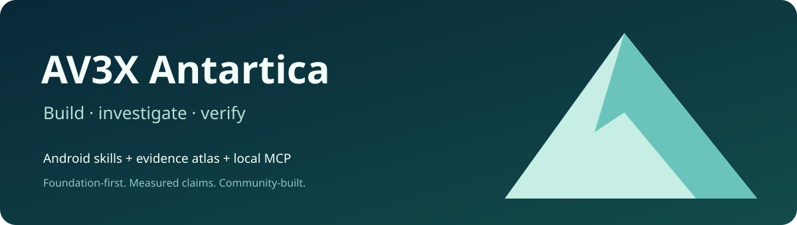

<p align="center"></p>

# AV3X Antartica · Android Atlas for Codex

[](https://github.com/ilanvkn/av3x-antartica/actions/workflows/check.yml)

**An evidence-backed Android development companion: reusable skills, a local reference atlas and thirteen read-only MCP tools.**

Use `$android` to build SDK-native apps, investigate an APK with appropriate companion tools, reason about CPU/GPU behavior and plan tests with explicit evidence. The learning path connects machine code → assembly → kernels → runtimes → applications.

**Current release: `3.2.0-antartica.7` · community preview · MIT.** The version describes a package, not Android coverage or an OS completion percentage. This is an independent community project, not an official Android, Google, Apple or OpenAI product.

[Start here](plugins/android/docs/WALKTHROUGH.md) · [MCP guide](plugins/android/docs/MCP.md) · [Project comparisons](plugins/android/docs/COMPARISONS.md) · [Coverage & gaps](plugins/android/docs/STATUS.md) · [Contribute](CONTRIBUTING.md)

## What can I do with it?

| Your task | What Antartica provides | What still does the work |
| --- | --- | --- |
| Build a native app | AndroidX/SDK workflow, project inspection and a reviewed maps scaffold | Codex editing your project; your SDK/JDK and Gradle |
| Understand a slow interaction | CPU/GPU/frame references, bounded frame-dump analysis | Your recorded traces and matched runtime measurements |
| Investigate an APK or firmware | Artifact-identity and REA investigation plans, source/version boundaries | Separately installed analysis tools and authorized artifacts |
| Learn the foundations | 52 dated topics with provenance, evidence levels and limitations | Upstream documentation, source reading and new experiments |
| Review an adaptation proposal | Deterministic response-age/recovery checks and reject/quarantine decisions | A human-reviewed implementation; this package has no executor |

## Install in Codex

You need Codex and an existing **Node.js22+**. The atlas/MCP server has no production npm dependencies. Android SDK/JDK17 are needed only when building Android examples.

```sh
git clone https://github.com/ilanvkn/av3x-antartica.git
cd av3x-antartica
codex plugin marketplace add . --json
codex plugin add android@av3x-antartica --json
```

Start a refreshed chat, then try:

> Use $android to inspect my Android project and implement an accessible offline screen. Build it with my existing toolchain and tell me what actually passed.

The marketplace is included in this repository. This uses Codex's supported compatibility manifest; other clients can use the [standalone stdio MCP setup](plugins/android/docs/MCP.md). Client versions and plugin policies may differ. Official packaging and marketplace guidance: [OpenAI plugin documentation](https://developers.openai.com/plugins/build/plugins).

## Try it before installing

```sh
node plugins/android/scripts/atlas.mjs status
node plugins/android/scripts/atlas.mjs search 'GPU'
node plugins/android/scripts/atlas.mjs lookup gpu-frame-engine-lab
node scripts/check.mjs
```

Read the bundled [table of contents](plugins/android/atlas/CONTENTS.md). The self-contained HTML reader is `plugins/android/atlas/index.html`; its rendered keyboard/assistive acceptance remains open. Local CLI/MCP retrieval is tested separately.

## Thirteen MCP tools

| Purpose | Tools |
| --- | --- |
| Retrieve references | `android_status`, `android_toc`, `android_search`, `android_lookup`, `android_compare` |
| Inspect and plan development | `android_sdk_doctor`, `android_inspect_project`, `android_development_plan`, `android_acceptance_plan`, `android_rea_plan` |
| Check explicit contracts | `android_v3_check`, `android_v3x_guard` |
| Analyze a supplied capture | `android_frame_stats` |

The server reads selected local files and returns bounded data. It does not execute builds, install software, control devices, change model weights or grant privileges. Read-only is not a host filesystem sandbox. The separate scaffold CLI writes source only to an explicitly chosen empty directory. [Trust boundaries](SECURITY.md).

## A real example: Maze — Malaysia Way

The [source-only map starter](plugins/android/examples/maze-map) uses Kotlin, Compose and MapLibre Native. It demonstrates Day/Night appearance, compact trip controls, saved routes, small offline areas and bounded service failure handling.

**The included lab server has labelled sample search and recorded road data.** It is not a live routing service. The production variant requires a deliberately configured gateway. Fully offline Malaysia-wide shops/search/routing is an active separate [Maze application](https://github.com/ilanvkn/maze-malaysia-way), with its own data recipes and qualification limits. It is not a capability of the bundled starter. This atlas includes a [pinned community pipeline lesson](plugins/android/atlas/articles/maze-offline-community-pipeline.md). No complete coverage of shops, entrances or exits is claimed.

```sh
node plugins/android/scripts/scaffold.mjs --template maps \
  --output /absolute/new-map-project \
  --application-id my.example.maps --name 'My Maps'
```

Review provider policies and attribution before adding services or datasets. The template does not embed the public Nominatim search endpoint. A maps scaffold is not an automatically completed navigation product or game engine.

## Where we fit

Antartica connects evidence retrieval, app-development workflow and honest acceptance reporting. It can complement [Now in Android](https://github.com/android/nowinandroid), [Mobile MCP](https://github.com/mobile-next/mobile-mcp), [Maestro](https://github.com/mobile-dev-inc/Maestro), [MapLibre Native](https://github.com/maplibre/maplibre-native) and [Organic Maps](https://github.com/organicmaps/organicmaps). These projects solve different problems; our [comparison](plugins/android/docs/COMPARISONS.md) explains what to learn from each. No head-to-head superiority or novel platform vulnerability is claimed.

## Evidence and limitations

The public package runs 30 Node regression tests plus a fresh-process MCP smoke check and payload integrity verification. Historical app and emulator findings are summarized with their actual boundaries in the atlas; raw private research cases are not redistributed. `case://local/…` locators identify unbundled historical records and are not working download links.

The M5 experiment did not establish an app-code speedup, physical FPS or energy savings. The maps lab's final main runner was8/9 with a selector error; its separate corrected search check passed on the same artifact. Device, API and test scope matter. See [status](plugins/android/docs/STATUS.md) before reusing claims.

## Updates and community

Report bugs and missing evidence in [Issues](https://github.com/ilanvkn/av3x-antartica/issues). Include the package version, exact command or tool arguments, expected/observed behavior and a minimal non-sensitive example. Feature requests and evidence corrections are welcome; read [CONTRIBUTING.md](CONTRIBUTING.md).

Maintainers review source/provenance changes, regenerate the atlas and run checks before tagging a release. CI tests Node 22/24 on Linux and macOS. No telemetry, automatic device operation or background self-updater is bundled. The project does not edit model weights or automatically learn from users.

Original plugin code, articles and original assets are [MIT licensed](LICENSE). Third-party code, datasets, services and trademarks retain their own terms: [notices](plugins/android/THIRD_PARTY_NOTICES.md).

Related community tools: [Reverse Lab, Apple Blueprint, Thesis Pro and Blender Asset Lab](https://github.com/ilanvkn/codex-engineering-plugins), plus [KSlides](https://github.com/ilanvkn/kslides). Their verification and installation contracts remain separate.
