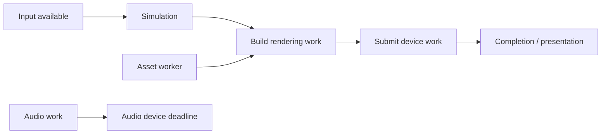

# Android CPU scheduling, ART and memory

**Scope:** Android 17 AOSP android-17.0.0_r1; QPR1 GSI metadata CP3A.260905.010 is not a proven source/binary match.

**Evidence level:** source-inspected. This names the main evidence anchor, not universal verification of every explanatory statement.

Android does not run an app catalog simultaneously. It supports an ecosystem through common contracts; each device runs a limited working set of processes and threads. CPU scheduling, runtime compilation, memory management and framework services cooperate to keep that working set useful. They solve different problems, so there is no single “Android engine” that performs all of them.

This chapter combines **documented architecture**, **observed pinned source**, and clearly marked **derived explanations**. The source is `android-17.0.0_r1`; the selected shipped image in this case is Android 17 QPR1. Their compiled equivalence is unverified. No CPU trace, benchmark, emulator execution or physical-device experiment was performed for this chapter.

## 1. Separate process, thread and CPU

A process supplies an execution environment, including an address space and resources. Threads are execution streams inside that environment. A device can have many existing threads while only a much smaller set is executing instructions at an instant. Others may be runnable but waiting, or blocked until an event occurs. App components usually share the app's main thread unless work is explicitly moved elsewhere. [Android processes and threads](https://developer.android.com/guide/components/processes-and-threads).

Linux's fair-scheduling documentation describes distributing CPU time among runnable tasks. Current kernel documentation also explains the transition from CFS toward EEVDF; that does **not** identify the scheduler inside our unexamined target kernel. We need the matched kernel build and configuration before making that claim. [CFS background](https://docs.kernel.org/scheduler/sched-design-CFS.html), [EEVDF](https://docs.kernel.org/scheduler/sched-eevdf.html).

**Derived example:** eight runnable workers do not imply eight useful operations progressing in parallel. They might contend for a lock, wait on the same remote service, or exceed the available execution resources. Conversely, a blocked thread consumes elapsed time without continuously consuming CPU time. Distinguish **wall-clock latency** from **CPU execution time** before diagnosing performance.

## 2. Android applies policy; the kernel performs scheduling

**Documented.** Android task profiles group resource-control actions and let framework code request a policy without hard-coding every cgroup path. Profiles can apply to a process or thread. Their configuration determines how abstract categories become resource restrictions. [Cgroup/task-profile architecture](https://source.android.com/docs/core/perf/cgroups).

**Observed source.** In the retained scheduling wrapper, a zero thread ID becomes the current thread ID. Background, foreground and top-app categories select different named profiles. CPU-set selection and scheduling-profile selection are distinct functions, and profile application can return failure. [CPU-set mapping](case://local/android-ios-reverse-lab/epoch-4/android-source/sched_policy.cpp:42), [scheduling mapping](case://local/android-ios-reverse-lab/epoch-4/android-source/sched_policy.cpp:124).

**Derived.** A profile name is a policy request, not proof that a particular core, frequency or deadline was obtained. The actual profile definitions, vendor configuration, kernel support and return values matter. Raising an application's conceptual importance also cannot fix a dependency blocked on I/O or a lock owner that is not making progress.

**Unknown:** the selected QPR1 image's active profiles, kernel CPU topology, frequency decisions and thermal limits. We have not measured any foreground/background scheduling difference.

## 3. ART chooses an execution representation; it is not the CPU scheduler

**Documented.** ART can execute DEX through interpretation or compiled forms. JIT compilation happens during execution; AOT artifacts can be prepared earlier. Profiles influence compilation choices, and an OAT artifact need not contain compiled code for every method. Code-cache contents and profile snapshots are not a complete history of everything executed. [ART compilation workflow](https://source.android.com/docs/core/runtime/jit-compiler).

**Derived:** there are two different queues to understand. The kernel chooses which runnable thread gets CPU time. The runtime chooses which method deserves compilation work and which available representation to execute. A compiler worker is itself a thread competing for CPU resources. Compiling a method can reduce future execution cost, but compilation has an immediate CPU and memory cost.

A native library is a separate case: its machine code must match an ABI, including instruction-set and calling conventions. Managed bytecode portability does not make every embedded native library portable across CPUs. [Android native ABIs](https://developer.android.com/ndk/guides/abis).

## 4. The real JIT source has queues, eligibility checks and fallback paths

**Observed source.** This ART revision creates a named JIT worker pool with a requested worker count and selects its priority from runtime options. Its baseline and optimized enqueue paths check whether suitable code already exists before adding work. The optimized path is conditional on compiler options. [Worker creation](case://local/android-ios-reverse-lab/epoch-4/android-source/jit.cc:1131), [enqueue decisions](case://local/android-ios-reverse-lab/epoch-4/android-source/jit.cc:1479).

The compilation function can decline work for deoptimized or no-longer-compilable methods, unmet class-initialization conditions, or existing compiled code. It invokes the compiler only after those checks and records whether compilation succeeded. [Compilation gate](case://local/android-ios-reverse-lab/epoch-4/android-source/jit.cc:157).

**Derived.** “A method became hot” is weaker than “optimized code was installed and executed.” There are intervening queue, eligibility, compilation and execution-selection boundaries. A debugger or class redefinition can also affect the path. **Unknown:** the particular QPR1 app's compilation options, profiles, code cache and executed method versions. The constant visible in one worker-creation call is not a universal claim about every ART configuration or all runtime threads.

## 5. Binder adds concurrency and waiting across processes

**Documented.** Synchronous Binder calls wait for a reply; one-way calls do not wait for the remote application work to finish. A service receives work through a thread pool. One-way transactions on the same node are serialized, while work involving different nodes can overlap. Nested synchronous calls can re-enter a caller, so even a small thread pool does not remove concurrency concerns. [Binder threading](https://source.android.com/docs/core/architecture/ipc/binder-threading).

**Observed source from the earlier round.** The retained Binder client distinguishes ordinary and one-way response handling and maps dead/failed responses into errors. That is transport behavior, not proof that a requested service action completed. [Retained transaction path](case://local/android-ios-reverse-lab/epoch-2/android-source/IPCThreadState.cpp:921).

**Derived scenario:** the UI thread calls a service, which waits for another service, which needs a lock held by the first caller. More CPU cores do not break that dependency cycle. Likewise, adding Binder threads may reduce a queue bottleneck but cannot make shared state correct automatically. To explain a slow call, connect caller waiting time, server dispatch, nested calls and the eventual reply instead of reading only one stack trace.

## 6. “Real-time” describes a deadline requirement, not simply speed

A UI animation, audio stream or game often has a useful completion time. Missing it can produce a repeated frame, delayed input or an audio glitch. This is usually discussed as **soft real-time** behavior: lateness degrades the result. A **hard real-time** claim instead requires bounded completion under specified worst-case conditions. Those are definitions for reasoning, not a classification measured on this target.

Linux provides deadline scheduling with runtime, period and deadline parameters; its documentation ties guarantees to admission control and available capacity. A scheduling policy alone is not a proof of an application's entire end-to-end bound. [Kernel deadline scheduling](https://docs.kernel.org/scheduler/sched-deadline.html).

**Derived arithmetic, not a benchmark:** a 60 Hz presentation interval is about 16.67 ms; at 120 Hz it is about 8.33 ms. An illustrative audio block of 192 frames at 48,000 frames/second spans 4 ms. These are intervals, not guaranteed CPU budgets. Input, queues, CPU work, synchronization, device work and presentation all affect when a result becomes observable. Pipelines can overlap, so neither “add every stage blindly” nor “look only at CPU work” is a sound latency model.

## 7. An engine is a dependency graph running on these mechanisms

**Derived learning model.** A game or media engine may schedule simulation, asset decoding, scene preparation, rendering submission and audio work on different threads. The OS sees threads and resource requests; it does not automatically know every application dependency. The engine must arrange what can overlap and what must wait.

Consider this deliberately simplified frame:

A worker doing unrelated asset preparation may overlap simulation. But if the rendering stage waits for that worker's result, the wait lies on the critical path. Making an off-path task faster may improve throughput without shortening the frame. CPU and GPU/device work are also different execution domains; a CPU thread can be waiting for device completion rather than executing slowly.

This model is useful for reading a trace, but no engine task graph or GPU command stream has been recovered here. The next evidence should identify actual dependencies and synchronization points before assigning blame to CPU speed, compiler quality or graphics hardware.

## 8. Memory pressure can make a CPU problem look like something else

**Documented.** Android's low-memory daemon watches system pressure and can remove less essential processes. Pressure-stall information measures time lost due to shortages rather than merely reporting free memory. [lmkd and PSI](https://source.android.com/docs/core/perf/lmkd).

Android 17 documentation adds a per-app Memory Limiter based on cgroup v2. Its mechanisms include a soft memory threshold and swap limits; reclaim and throttling may occur before an extreme allocation failure terminates an app. This is different from ART's managed-heap accounting and from a system-wide low-memory kill. [Memory Limiter](https://source.android.com/docs/core/perf/memory-limiter), [Android 17 behavior changes](https://developer.android.com/about/versions/17/behavior-changes-all).

**Derived.** High latency with modest CPU usage can come from memory stalls, page activity, locks or remote waits. A process disappearing is not automatically a Java exception. Diagnose the actual exit reason and pressure evidence. **Unknown:** whether this selected runtime enforces particular limits, its thresholds, reclamation activity or the cause of any real termination. No termination was induced.

## 9. How a large app ecosystem builds on one platform

**Documented.** Android compatibility defines shared software/hardware expectations through requirements and tests. Applications still declare feature/version requirements and adapt to device variability. Native dependencies additionally need suitable ABIs. [Compatibility program](https://source.android.com/docs/compatibility/overview), [app/device compatibility](https://developer.android.com/guide/practices/compatibility).

**Derived.** The scaling comes from reuse, not loading millions of programs into one phone. Developers target a common API environment; the platform implements those services across hardware families. Individual devices install a subset, execute a smaller active set, and manage inactive processes and resources. App libraries reuse platform abstractions while services centralize work that should not be independently reimplemented by every app.

Compatibility also has layers: package/resource interpretation, runtime behavior, native ABI, available features and service semantics. Matching only the API names would not establish compatibility. Nor does a successful launch prove correct camera behavior, lifecycle handling, permissions or timing. A source tree, generic image and emulator each reveal different portions of that contract. We have not run CTS or validated an app corpus in this investigation.

## 10. Learn by separating latency causes

For one future controlled operation, capture the request, participating process/thread identities and the completion. Classify intervals rather than labeling the whole operation “slow”:

| Interval | Question to answer |
| --- | --- |
| Runnable but not executing | Was the thread awaiting CPU availability or restricted by policy? |
| Executing | Which work consumed CPU, and which representation ran? |
| Blocked on a dependency | Lock, Binder peer, storage, network or device completion? |
| Runtime work | Compilation, class initialization, allocation or collection? |
| Result ready but not visible | Did queueing or presentation delay observation? |

This is an analysis template, not a trace collected from the selected build. It tells us what evidence to gather next without assuming the answer.

Exercises using the retained source:

1. Follow a top-app scheduling request to its profile name. Identify the missing configuration needed to turn that name into a CPU-placement claim.
2. Find three reasons a JIT request can return without compiling. Explain why they are not all compiler errors.
3. Draw a synchronous Binder call with a nested callback. Mark where a held lock could cause trouble.
4. Explain why one expensive worker off the critical path might not increase input latency, while a short locked section on the critical path might.
5. Separate a managed out-of-memory exception, per-app limiter event and system-pressure process kill. State what evidence distinguishes them.

## Evidence and remaining gaps

Two complete source files were acquired from official AOSP and hashed: scheduling policy at core commit `545d2487e38192a2ce25040897ced877cf6b4f53`, and ART JIT at `b753cf97923c3695338d21466fa14c57b480a59a`. [Provenance](case://local/android-ios-reverse-lab/epoch-4/android-source/provenance.json), [hash verification](case://local/android-ios-reverse-lab/epoch-4/android-source/verification.json), [source findings](case://local/android-ios-reverse-lab/epoch-4/android-source/findings.json).

These anchors explain real source mechanisms, not exact compiled behavior on Android 17 QPR1. Missing evidence includes the matched kernel/configuration, active task profiles, compiler/module versions, controlled workload, scheduler/runtime trace, GPU/device timeline and end-to-end latency distribution. No claim of hard real-time qualification, throughput or comprehensive platform equivalence is made.

## Evidence and limits

Separate CPU scheduling from ART execution representation and examine policy/profile source boundaries.

- No device or emulator execution is represented by this entry.
- Evidence levels label the main retained anchor; documentation and derived explanations are not extra runtime proof.
- This is imported case-authored teaching material, not a new independent verification.
- Pinned source observation does not establish behavior of the selected shipped binary or device.

Original case-authored material: [android-cpu-runtime.md](case://local/android-ios-reverse-lab/epoch-4/android-cpu-runtime.md). Raw evidence remains in the local case; the atlas contains explanatory text only.
