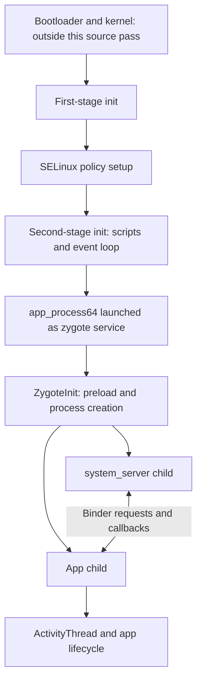

# Android startup: init to application lifecycle

**Scope:** Android 17 AOSP android-17.0.0_r1; QPR1 GSI metadata CP3A.260905.010 is not a proven source/binary match.

**Evidence level:** source-inspected. This names the main evidence anchor, not universal verification of every explanatory statement.

This chapter follows real source edges rather than treating Android as one program. It uses the official `android-17.0.0_r1` tag, resolved separately for each repository. The selected shipped image elsewhere in this case is Android 17 QPR1. **The source is a useful baseline, but its equivalence to that QPR1 binary is unverified.** No Android device or emulator was run for this chapter.

The evidence labels matter: **observed source** means a statement is visible in the pinned code; **derived** means the explanation follows from those statements; **documented** means an official architectural description; **unknown** marks an unanswered implementation or runtime question. Repository source inspection is not REA decompilation.

## 1. Read the system as cooperating processes

An APK is an installation package; a process is a running execution context; a service is a role that code performs. They are not interchangeable. A package can have several components, and the code that implements a system feature can cross process boundaries. ART runs managed DEX code; native libraries use the CPU instruction set. The Linux kernel supplies lower-level execution and isolation mechanisms. [Official platform architecture](https://developer.android.com/guide/platform/index.html).

Think of one task, such as starting an app, as a chain of handoffs. At every arrow, ask four questions: Who is the caller? What data crosses the boundary? What identity or permission travels with the request? What happens if the receiver fails? Those questions turn a large codebase into a sequence of testable claims.

The first arrow is architectural context, not a recovered boot trace. The selected GSI does not contain every bootloader or vendor component needed to reproduce a physical device.

## 2. Init changes jobs as startup progresses

**Observed source.** The previously retained `init/main.cpp` selects a path from its executable name and command-line arguments. The first stage prepares the environment and hands execution to another invocation with `selinux_setup`. Mount or exec failures can terminate startup rather than allowing normal continuation. [Retained dispatcher](case://local/android-ios-reverse-lab/android/init-main.cpp:56), [first-stage handoff](case://local/android-ios-reverse-lab/android/first-stage-init.cpp:551).

The next stage loads the Android or Microdroid policy depending on a branch, sets enforcement, restores the security label of the next init executable, and executes it with `second_stage`. Label restoration and exec failure have explicit fatal branches. Optional overlay handling can take a different route. [Pinned SELinux setup](case://local/android-ios-reverse-lab/epoch-2/android-source/selinux.cpp:785).

**Derived.** A file named `init` does not imply that only one initialization phase exists. The same executable path participates in different stages with different preparation and security requirements. A useful reverse-engineering trace therefore records arguments and context, not just filenames.

**Unknown.** We have not recovered the actual policy loaded by the QPR1 image or observed which optional branches run. Seeing a call named “set enforcement” is not proof that every target is enforcing: the helper, build flags, boot configuration and kernel state must also be examined.

## 3. Second-stage init becomes a scheduler for system work

**Observed source.** `LoadBootScripts` reads init configuration from system, system_ext, vendor, odm and product locations unless a boot property selects another script. Startup queues events including early initialization and later initialization. Its main loop executes queued commands, handles process actions and control messages, and waits for events. [Script loading](case://local/android-ios-reverse-lab/epoch-2/android-source/init.cpp:347), [event queue](case://local/android-ios-reverse-lab/epoch-2/android-source/init.cpp:1239), [main loop](case://local/android-ios-reverse-lab/epoch-2/android-source/init.cpp:1289).

**Derived.** A service definition is not proof that the service started. Conditions, class activation, property triggers, restart state and earlier failures can affect whether and when it runs. Reading only the service stanza would miss those dependencies.

One retained configuration defines the 64-bit zygote service using `app_process64`, declares its socket, and lists restart actions affecting several related services. This is one configuration, not proof that every Android device uses only one 64-bit zygote. [Zygote service definition](case://local/android-ios-reverse-lab/epoch-2/android-source/init.zygote64.rc:1).

**Learning check.** If a service is present in an init script but absent at runtime, what three things would you inspect next? A defensible answer includes the script import path, activation trigger and service failure/restart state. None requires assuming the declaration was ignored.

## 4. Zygote connects native startup to managed processes

**Observed source.** `app_process` parses its mode and starts either the Zygote Java entry class or the ordinary runtime entry class. A missing class/mode has a fatal branch. [Native-to-Java dispatch](case://local/android-ios-reverse-lab/epoch-2/android-source/app_main.cpp:257).

In the Zygote Java entry, preload may happen eagerly or be deferred. A requested system-server launch constructs arguments, calls the process-creation path, and distinguishes parent from child. The child closes the inherited server socket and follows the system-server initialization path. The parent continues accepting commands. [Preload/dispatch](case://local/android-ios-reverse-lab/epoch-2/android-source/ZygoteInit.java:883), [system-server fork](case://local/android-ios-reverse-lab/epoch-2/android-source/ZygoteInit.java:699).

**Derived.** “Launch an app” is not simply “execute its APK.” Android prepares an execution environment and specializes child processes. Zygote helps explain why shared initialization and app-specific execution are separate subjects. The official description also discusses secondary zygotes and unspecialized app processes, so a single linear diagram is an introductory route, not every configuration. [Zygote architecture](https://source.android.com/docs/core/runtime/zygote).

**Unknown.** The native implementation of process specialization, exact identity transitions, memory sharing and the selected target's optional process-pool behavior still need separate inspection. The Java call alone does not prove those mechanisms.

## 5. System server starts services in dependency order

**Observed source.** The `SystemServer` entry creates an instance and runs it. Startup prepares a main event loop and a system-service manager, then calls bootstrap, core, other and APEX service phases. Failure escaping that startup block is logged and rethrown. After initialization, the main loop is expected to persist; returning from it raises an error. [Entry](case://local/android-ios-reverse-lab/epoch-2/android-source/SystemServer.java:726), [startup phases](case://local/android-ios-reverse-lab/epoch-2/android-source/SystemServer.java:1041), [persistent loop](case://local/android-ios-reverse-lab/epoch-2/android-source/SystemServer.java:1096).

The bootstrap code initializes access-checking services and connects the activity/task managers before later package-manager work. **Derived:** ordering expresses dependencies. Moving initialization arbitrarily can fail even when every class is present. A reverse-engineering graph should therefore preserve order, guards and failure paths, rather than becoming a flat list of service names. **Unknown:** the concrete service implementations and every boot-phase callback remain outside this pass; this is not a proof that all services share the same process or failure policy.

## 6. Runtime initialization selects the entry point

**Observed source.** `RuntimeInit.applicationInit` sets target-SDK/compatibility data and resolves the start class. `findStaticMain` loads the class, finds its `main` method, checks that the method is public and static, and returns a runnable wrapper. Missing classes, missing methods and unacceptable modifiers have explicit error branches. [Application initialization](case://local/android-ios-reverse-lab/epoch-2/android-source/RuntimeInit.java:372), [entry-point checks](case://local/android-ios-reverse-lab/epoch-2/android-source/RuntimeInit.java:313).

**Derived.** The entry point is a checked contract. A plausible class name in a string inventory is weaker evidence than seeing how that name becomes a loaded class and then a method invocation. This is a practical example of why reverse engineering follows values and callers rather than stopping at search results.

**Unknown.** This source pass does not yet prove which entry class and classpath a particular QPR1 app process receives. The activity-manager request path and native fork path must be connected to the captured process parameters for that claim.

## 7. Binder turns a request into cross-process work

**Documented.** Binder lets one process call an interface implemented in another. The client-side proxy packages the destination, method identifier and arguments; the kernel driver transports the transaction; the receiving side dispatches it; a reply can travel back. AIDL describes interfaces and generates bindings. A same-process call can avoid the remote packaging path. [Binder overview](https://source.android.com/docs/core/architecture/ipc/binder-overview), [AIDL overview](https://source.android.com/docs/core/architecture/aidl).

**Observed source.** The retained native client path writes transaction data, distinguishes ordinary calls from one-way calls, and processes driver responses. The driver communication uses the Binder write/read ioctl. Dead-object and failed-transaction responses become distinct error results. [Transaction construction](case://local/android-ios-reverse-lab/epoch-2/android-source/IPCThreadState.cpp:921), [reply/error handling](case://local/android-ios-reverse-lab/epoch-2/android-source/IPCThreadState.cpp:1153), [driver boundary](case://local/android-ios-reverse-lab/epoch-2/android-source/IPCThreadState.cpp:1304).

**Derived.** One-way means the caller does not receive the ordinary application reply; it does not mean the local transport has no bookkeeping or cannot fail. This code still waits for an appropriate driver-level completion path. Similarly, a remote-call-shaped API is not a local function call in its failure semantics: another process can die, freeze or reject work.

**Unknown.** No particular service's permission check has been followed here. Binder transport and service authorization are separate questions. To investigate a sensitive operation, identify the concrete stub/implementation, then inspect caller identity handling, argument validation and state changes.

## 8. ART explains why an APK is not all executed machine code

**Documented.** ART executes DEX and supports managed execution. Its modern compilation workflow combines interpretation, just-in-time compilation and ahead-of-time artifacts; a saved OAT artifact does not necessarily contain compiled code for every method. Profiles can guide later compilation. Consequently, static inspection of an APK does not enumerate every machine-code body that may exist during execution. [ART overview](https://source.android.com/docs/core/runtime), [JIT/AOT workflow](https://source.android.com/docs/core/runtime/jit-compiler).

For learning, distinguish four objects: the package archive, its DEX bytecode, optional native libraries, and runtime-generated or precompiled artifacts. A decompiler may make bytecode readable, but it does not reproduce the original comments, build choices or exact source. Native code and dynamically loaded code require additional evidence.

**Unknown.** This round has not obtained a QPR1 system APK or traced one DEX method through ART. Compiler filters, profile state, method selection and runtime output remain unmeasured. A complete learning exercise would pick one small method, inspect its shipped representation, and compare observed execution under a controlled runtime.

## 9. Isolation spans more than the programming language

**Documented.** Android's application sandbox uses Linux identities and process boundaries, augmented by SELinux and other mechanisms. Native code remains subject to that operating-system boundary; changing languages does not automatically grant broader access. File-sharing and cross-process features use explicit interfaces and access rules. [Application sandbox](https://source.android.com/docs/security/app-sandbox).

**Derived learning model.** Separate three questions when reading code: whether the caller can reach an endpoint, whether the endpoint authorizes an operation, and what the kernel permits the resulting process to do. A permission string in an APK does not prove a permission was granted, checked correctly or sufficient for the requested operation.

## 10. An incoming application request can become queued work

**Observed partial source.** A complete-line prefix of `ActivityThread.java` was recovered after a transfer timeout. Within the retained prefix, `ApplicationThread` extends the generated Binder stub. Its application-binding method collects inputs and sends a message to a handler. The handler later calls the binding implementation; a separate transaction branch invokes the transaction executor. These are observed code edges, even though the whole file was not acquired. [Incoming endpoint](case://local/android-ios-reverse-lab/epoch-2/android-source/ActivityThread.java.partial:1202), [enqueue](case://local/android-ios-reverse-lab/epoch-2/android-source/ActivityThread.java.partial:1543), [dispatch](case://local/android-ios-reverse-lab/epoch-2/android-source/ActivityThread.java.partial:2754).

**Derived.** Receiving an IPC request and completing application initialization are different events. A trace that stops at the Binder endpoint can miss queued work and its later failures. **Unknown:** the binding implementation lies outside the retained prefix; this does not establish its full behavior or callback sequence.

**Documented context.** An activity moves through creation, starting, resuming, pausing, stopping and destruction callbacks. Component state and process lifetime differ: a process can be removed and later recreated. By default, app components share a process and main thread, but configurations can alter process placement. [Activity lifecycle](https://developer.android.com/guide/components/activities/activity-lifecycle), [processes and threads](https://developer.android.com/guide/components/processes-and-threads).

For an eventual runtime lesson, record a controlled app launch, background/foreground transition and process recreation. Compare callbacks and process IDs. Until that experiment is actually performed, the diagram is a learning hypothesis, not a measured trace.

## Evidence-backed questions and next experiments

| Question | Current answer | Next evidence needed |
| --- | --- | --- |
| Does startup have distinct init phases? | Observed in pinned source. | Map the QPR1 compiled init and capture startup arguments. |
| Does second-stage init only run once and exit? | Source shows a persistent event loop. | Runtime lifetime and event traces. |
| Is the zygote service definition enough to prove it ran? | No; activation and execution are separate. | Matched configuration plus process/startup evidence. |
| How is system_server selected? | Explicit entry class and child-process branch observed. | Native specialization and matched classpath. |
| Is Binder error-free because calls resemble methods? | No; explicit remote/transport failure handling exists. | Controlled dead-peer and failing-service observations. |
| Does this prove Android 17 QPR1 behavior? | No; source release and binary revision differ. | Matched compiled artifacts and controlled observations. |
| Does an APK decompilation cover ART-generated code? | No; execution representations can differ. | Runtime/compiler artifacts for the selected method. |

Try these exercises using the retained files, without operating a device:

1. Trace the first-stage-to-SELinux-to-second-stage handoffs and write down the argument at each boundary. Identify one fatal path per stage.
2. Locate one point where a declaration is weaker than runtime proof. Explain the missing observation.
3. Follow the ordinary Binder request path and then the one-way branch. Explain what kind of completion each expects.
4. In RuntimeInit, list the checks required before calling the selected entry method. Predict the error category when each check fails.
5. Draw two separate boxes for Zygote and system_server. Mark the parent/child branch and socket cleanup. Explain why treating both as one process would be misleading.

The answers are discoverable from the source links above. These exercises test interpretation of real evidence; they do not claim that a device passed an acceptance test.

## Provenance and limitations

Pinned repository commits:

| Repository | Commit |
| --- | --- |
| platform/system/core | `545d2487e38192a2ce25040897ced877cf6b4f53` |
| platform/frameworks/base | `94b4c163b7dfe5ce3607f7bb8456f9573f7de57d` |
| platform/frameworks/native | `ae266dcb706d083868578cfedce381ef44488a07` |

[Acquisition provenance](case://local/android-ios-reverse-lab/epoch-2/android-source/provenance.json) records each official URL, file hash and transfer status. The tag was resolved through HTTPS repository metadata; no signed-tag verification was performed. Sources were read and locally hashed, not compiled. Hardware-specific boot, vendor HAL implementations, kernel internals, app installation, full activity lifecycle, compositor, media, networking and update behavior are not comprehensively covered here. The latest device-specific Android build is also a separate question from this reference source tag and selected GSI.

Transfer note: SystemServer was recovered on a longer bounded retry. ActivityThread failed first on read timeout, then HTTP/2 framing, and finally HTTP/1.1 timed out after 253,926 transfer bytes. Only its 190,374-byte complete-line decoded prefix (4,194 lines) is retained as `.partial`; it is not a complete source file. No acquisition remains running.

## Evidence and limits

Trace pinned source from staged init through zygote, system_server, runtime entry checks and Binder dispatch.

- No device or emulator execution is represented by this entry.
- Evidence levels label the main retained anchor; documentation and derived explanations are not extra runtime proof.
- This is imported case-authored teaching material, not a new independent verification.
- Pinned source observation does not establish behavior of the selected shipped binary or device.

Original case-authored material: [android-learning.md](case://local/android-ios-reverse-lab/epoch-2/android-learning.md). Raw evidence remains in the local case; the atlas contains explanatory text only.
